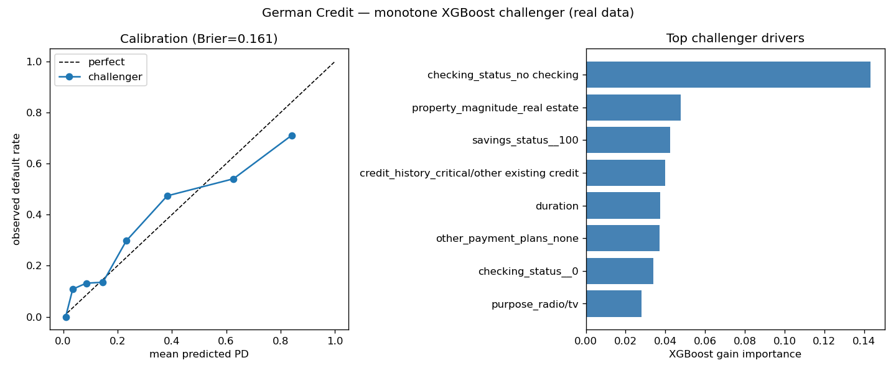
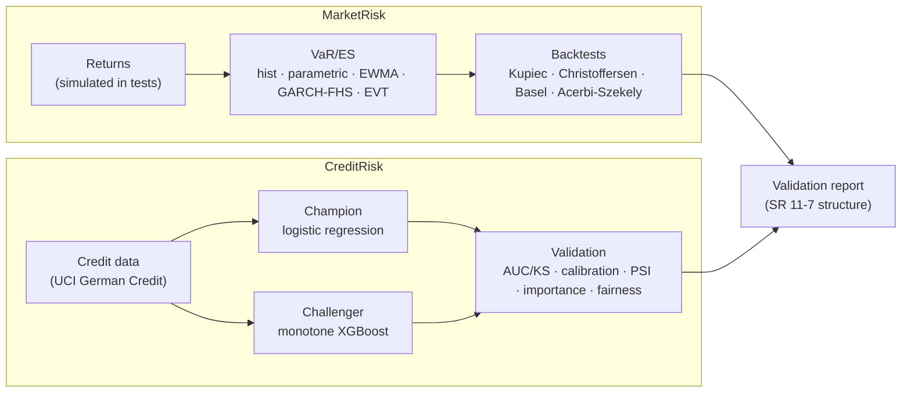

# Model-Risk & Validation Platform

[](https://github.com/kbd0011/model-risk-platform/actions/workflows/ci.yml)
[](LICENSE)
[](https://www.python.org/)

> **Result (public UCI German Credit, 300-loan stratified hold-out).** The monotone-constrained XGBoost
> challenger reaches **AUC 0.812** (KS 0.544, Brier 0.161) against **0.796** (KS 0.503) for the logistic
> champion. The monotone constraints cost no measurable discrimination: the unconstrained model scored 0.014
> AUC lower. Train-to-hold-out score PSI is 0.04, and a four-fifths test flags applicants under 25
> (**adverse-impact ratio 0.665**), with age itself among the model inputs. The market-risk engine implements
> five VaR/ES methods and four backtests, each checked in unit tests on simulated data. Write-up:
> [`reports/validation_report.md`](reports/validation_report.md).



**What it is.** One validation workflow applied to two model classes: (A) a **market-risk** VaR/Expected
Shortfall engine with Kupiec, Christoffersen, Basel traffic-light and Acerbi-Szekely backtests, and (B) a
**credit-risk** PD champion/challenger pair (logistic regression vs monotone-constrained gradient boosting)
tested for discrimination, calibration, stability, feature importance and disparate impact. Both feed a
validation report I wrote on my own models, organized around the validation elements of SR 11-7 (now
superseded by SR 26-2, April 17, 2026) and ending in recommendations.

## Pipeline


## Layout
```
model-risk-platform/
├── src/market_risk/var_models.py      # historical / parametric / EWMA / GARCH-FHS / EVT-POT rolling VaR + ES
├── src/market_risk/var_backtests.py   # Kupiec POF, Christoffersen independence + conditional coverage, Basel traffic light
├── src/market_risk/es_backtests.py    # Acerbi-Szekely Z2 with Monte-Carlo p-value + ES traffic light
├── src/credit_risk/woe_scorecard.py   # WOE/IV binning, monotonic bin merging, PDO scorecard scaling
├── src/credit_risk/challenger.py      # monotone-constrained XGBoost + cost of monotonicity
├── src/credit_risk/validation.py      # AUC/KS/Gini, calibration/Brier, PSI/CSI, SHAP importance, adverse-impact ratio
├── src/credit_risk/data.py            # synthetic, CSV and OpenML credit loaders
├── scripts/run_german_credit.py       # end-to-end credit run on UCI German Credit -> metrics + figure
├── reports/validation_report.md       # validation report (SR 11-7 structure)
├── tests/                             # unit tests for every src module (no network)
├── IMPLEMENTATION_LOGIC.md · DATA.md · LLM_PROMPTS.md
└── Makefile · requirements.txt · pyproject.toml
```

## Reproduce
```bash
make setup && make check   # install, then lint + typecheck + test (the same steps CI runs)
make run                   # UCI German Credit validation -> printed metrics + assets/credit_validation.png
```
`requirements.txt` sets minimum versions only, so challenger metrics can differ slightly under newer xgboost
releases.

## Design decisions
- **Champion + challenger, not one model.** The transparent logistic champion is the benchmark; the boosted
  challenger has to beat it while staying monotone, and the cost of that constraint is measured, not assumed.
- **Monotone constraints from the data.** Each feature's direction comes from its rank correlation with
  default on the training split, so the challenger cannot reverse the risk direction seen in training.
- **Fairness reported as found.** The disparate-impact test fails four-fifths, and the report traces it partly
  to age being a direct input and recommends removing it, rather than leaving the result out.
- **ES backtested separately from VaR.** A unit test builds a model whose VaR exception count is right but whose
  tail is too thin; an exception count would not flag it, and the Acerbi-Szekely test rejects it.

## Scope and limitations
- Credit results come from one 700/300 split of a 1,000-loan public dataset; the AUC gap between champion and
  challenger has not been significance-tested.
- The champion is a logistic stand-in. The WOE/IV scorecard module is implemented and unit-tested but not yet
  wired into the German Credit run.
- The committed figure shows XGBoost gain importance; SHAP is implemented in the validation library but
  failed under the local shap/xgboost versions when the figure was produced.
- Market-risk evidence is the unit-test suite on simulated returns; the engine has not yet been run on a real
  P&L series.
- The fairness test covers one protected attribute at one approval threshold. It is a model finding, not a
  fair-lending determination.

**Next:** bootstrap/DeLong comparison of the AUCs; retrain without age and re-test disparate impact; wire in the
WOE scorecard as champion; scale to Home Credit or Give Me Some Credit with LGD/EAD and reject inference; run
VaR/ES on a real multi-asset P&L series.

## References
- Board of Governors of the Federal Reserve System / OCC (2011). *SR 11-7 — Supervisory Guidance on Model Risk Management.*
- Board of Governors of the Federal Reserve System (2026). *SR 26-2 — Revised Guidance on Model Risk Management* (supersedes SR 11-7).
- Basel Committee on Banking Supervision (1996). *Supervisory Framework for the Use of "Backtesting".*
- BCBS — *Fundamental Review of the Trading Book (FRTB)*, stressed Expected Shortfall.
- Kupiec, P. (1995). *Techniques for Verifying the Accuracy of Risk Measurement Models.* J. Derivatives.
- Christoffersen, P. (1998). *Evaluating Interval Forecasts.* International Economic Review.
- Acerbi, C. & Székely, B. (2014). *Backtesting Expected Shortfall.* Risk.
- McNeil, Frey & Embrechts. *Quantitative Risk Management* (EVT / peaks-over-threshold).
- Data: [UCI German Credit](https://archive.ics.uci.edu/dataset/144/statlog+german+credit+data) via OpenML.
